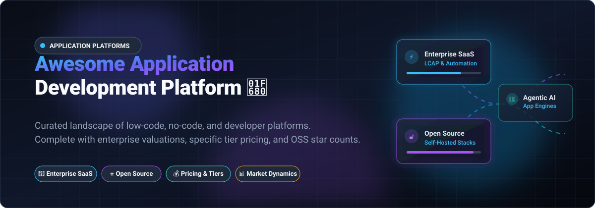

<div align="center">



# 🚀 Awesome Application Development Platform

<a href="https://github.com/ishandutta2007/Awesome-Awesome-Awesome"></a><a href="https://discord.gg/jc4xtF58Ve"></a>
[](https://github.com/ishandutta2007/Awesome-Awesome-Awesome)
[](./LICENSE)
[](https://github.com/ishandutta2007/Awesome-Application-Development-Platform/stargazers)
[](https://github.com/ishandutta2007/Awesome-Application-Development-Platform/pulls)
<a href="https://github.com/ishandutta2007"></a>

**A curated index of top-tier low-code, no-code, and rapid application development platforms (LCAP).**  
Featuring enterprise valuations/revenues, transparent starting prices, free tier & trial specifications, and trending open-source alternatives.

[Sector Overview](#-sector-overview--market-dynamics) • [Enterprise SaaS](#-enterprise-saas-platforms) • [Open Source](#-open-source-application-development-platforms) • [Contributing](#-contributing)

---

</div>

## 📊 Sector Overview & Market Dynamics

The worldwide low-code development technologies and application platform market was valued at approximately **$32 billion to $37 billion in 2024–2025** and is forecasted by Gartner and Fortune Business Insights to exceed **$58 billion by 2029** (and over **$300 billion by the mid-2030s** at a ~30% CAGR). The sector is **moderately fragmented**: mega-cap cloud ecosystems (such as Microsoft Power Platform and ServiceNow) capture the largest enterprise market share for internal back-office workflows, while pure-play high-productivity innovators (OutSystems, Mendix, Appian) and developer-focused internal tool engines (Retool, Appsmith) maintain strong moats in mission-critical core systems and developer workflows rather than a winner-take-all monopoly.

---

## 🏢 Enterprise SaaS Platforms

A comprehensive breakdown of leading SaaS application development platforms, sorted in descending order by company scale (market capitalization, private valuation, or annual revenue).

| Platform | Company Scale (Valuation / Revenue) | Starting Tier Pricing | Free Tier / Free Trial Limits | Description |
| :--- | :--- | :--- | :--- | :--- |
| **[Microsoft Power Apps](https://powerapps.microsoft.com/)** | **~$3.9T Market Cap** (Microsoft) | **$20/user/month** (Power Apps Premium, unlimited apps) or **$5/user/app/month** | **Free Developer Plan**: Lifetime access to 3 individual non-production environments with Microsoft Dataverse (~2GB cap) and standard/premium connectors for testing. | Enterprise low-code suite tightly integrated with Microsoft 365, Azure, Dataverse, and Copilot AI agents. |
| **[ServiceNow App Engine](https://www.servicenow.com/products/app-engine.html)** | **~$162B Market Cap** (ServiceNow) | **Free App Engine Starter** (included with core Now Platform contract) / Paid enterprise tiers start at **~$75-$180/creator/month** | **Personal Developer Instance (PDI)**: Lifetime free sandbox environment with App Engine Studio, hibernates after inactivity and wipes if unclaimed. | Low-code workflow and enterprise application automation platform built on the Now Platform backbone. |
| **[OutSystems](https://www.outsystems.com/)** | **$9.5B Valuation** (Private) | **~$36,300/year** (OutSystems Developer Cloud entry plan, custom quote) | **Free Personal Edition**: Lifetime free access for 1 developer, up to 100 non-production internal users, 1GB database storage (strictly non-commercial/dev use). | High-performance enterprise low-code platform for building complex, mission-critical web and mobile applications. |
| **[Appian](https://appian.com/)** | **~$3.75B Market Cap** (NASDAQ: APPN) | **~$75–$90/user/month** (Appian Standard tier, annual commitment) | **Free Community Edition**: Lifetime free access for prototyping with up to 15 users, 25,000 synced records, and 1 RPA robot. | Enterprise business process management (BPM) and unified low-code automation fabric. |
| **[Retool](https://retool.com/)** | **$3.2B Valuation** (Private) | **$10/builder/month** (+ $5/end-user/month on Team plan) | **Free Forever Plan**: Up to 5 users (builders + end-users), unlimited web/mobile apps, 500 workflow runs/month, 5GB Retool Database (Postgres), 250 AI credits/month. | The fastest developer platform to visually build custom internal dashboards, CRUD apps, and admin workflows. |
| **[Zoho Creator](https://www.zoho.com/creator/)** | **~$1.4B Annual Revenue** (Zoho Corp, Bootstrapped) | **$8/user/month** (billed annually for Standard plan) | **Free Forever Plan**: 1 user, 1 custom application, up to 5,000 data records, 250 API calls/day (plus 15-day full-feature trial). | Low-code application builder enabling businesses to quickly digitize operations and build relational database applications. |
| **[Mendix](https://www.mendix.com/)** | **$730M Acquisition** (€600M by Siemens, parent cap ~$140B) | **$1,090/month** (Standard 1-App Plan) or **$2,725/month** (Standard Unlimited Apps Plan) | **Free Forever Edition**: Lifetime full access to Mendix Studio Pro for prototyping, testing, and deployment to public Mendix Cloud (auto-sleeps during inactivity). | Model-driven low-code application development platform designed for enterprise-grade collaborative engineering. |
| **[Quickbase](https://www.quickbase.com/)** | **~$200M Annual Revenue** (Majority owned by Vista Equity Partners) | **$35/user/month** (Team Plan, billed annually, min. seats apply) | **30-Day Free Trial**: Complete access to all Business tier features, personalized dashboards, visual workflow automations, and sample data models. | No-code collaborative database application platform designed for complex operational project and workflow tracking. |
| **[Betty Blocks](https://www.bettyblocks.com/)** | **~$150M Valuation** ($36.5M funding raised) | **€1,500/month** (Create Plan with small app bundle) | **Free Sandbox Trial**: Evaluation sandbox to test AI prototyping and visual block creation with a 20-day grace period for project data. | Citizen developer friendly no-code/low-code platform with 100% cloud delivery and modular block architecture. |

---

## 🔓 Open-Source Application Development Platforms

Self-hostable, developer-friendly open-source alternatives for rapid application development, internal tooling, and full-stack app backends. Sorted in descending order by GitHub Stars_Counts.

| Platform | GitHub_Stars | Tech Stack | License | Description |
| :--- | :--- | :--- | :--- | :--- |
| **[Supabase](https://github.com/supabase/supabase)** | [](https://github.com/supabase/supabase/stargazers) | TypeScript, Elixir, Go | Apache-2.0 | Open-source Firebase alternative providing Postgres database, Authentication, instant Realtime APIs, Edge Functions, and Storage. |
| **[Strapi](https://github.com/strapi/strapi)** | [](https://github.com/strapi/strapi/stargazers) | JavaScript, TypeScript | Community / EE | The leading open-source headless CMS and API engine that developers use to design custom backends and administrative panels. |
| **[NocoDB](https://github.com/nocodb/nocodb)** | [](https://github.com/nocodb/nocodb/stargazers) | TypeScript, Vue | AGPL-3.0 | Open-source Airtable alternative that transforms any relational database (MySQL, PostgreSQL, SQLite, SQL Server) into a smart spreadsheet. |
| **[PocketBase](https://github.com/pocketbase/pocketbase)** | [](https://github.com/pocketbase/pocketbase/stargazers) | Go, Svelte | MIT | Open-source single-file backend for your SaaS and mobile apps with embedded SQLite, realtime subscriptions, auth, and admin UI. |
| **[ToolJet](https://github.com/ToolJet/ToolJet)** | [](https://github.com/ToolJet/ToolJet/stargazers) | TypeScript, React, Node.js | AGPL-3.0 | Low-code framework to build and deploy internal tools, customer portals, and database GUIs in minutes with 50+ integrations. |
| **[Appsmith](https://github.com/appsmithorg/appsmith)** | [](https://github.com/appsmithorg/appsmith/stargazers) | TypeScript, Java, React | Apache-2.0 | Powerful open-source low-code platform to build internal applications, admin panels, dashboards, and automated workflows. |
| **[Directus](https://github.com/directus/directus)** | [](https://github.com/directus/directus/stargazers) | TypeScript, Vue.js, Node.js | BSL 1.1 / Apache-2.0 | Open-source data platform that instantly layers an intuitive admin app and dynamic REST / GraphQL APIs over any SQL database. |
| **[Refine](https://github.com/refinedev/refine)** | [](https://github.com/refinedev/refine/stargazers) | TypeScript, React | MIT | React-based framework for rapid development of data-rich applications, internal tools, admin panels, B2B apps, and dashboards. |
| **[Budibase](https://github.com/Budibase/budibase)** | [](https://github.com/Budibase/budibase/stargazers) | TypeScript, Svelte, Node.js | GPL-3.0 | Open-source low-code platform for building modern business applications, forms, approval flows, and internal software. |
| **[ILLA Builder](https://github.com/illacloud/illa-builder)** | [](https://github.com/illacloud/illa-builder/stargazers) | TypeScript, Go, React | Apache-2.0 | Low-code platform with AI agent integration and visual canvas for assembling internal tools and automated actions. |
| **[Lowcoder](https://github.com/lowcoder-org/lowcoder)** | [](https://github.com/lowcoder-org/lowcoder/stargazers) | TypeScript, React, Java | AGPL-3.0 | Open-source, self-hosted low-code platform to build enterprise internal tools and connect seamlessly with data sources. |

---

## 🎯 Key Comparison: When to Pick Which Platform?

```
┌────────────────────────────────────────────────────────────────────────┐
│                      Application Platform Matrix                       │
├────────────────────────────────┬───────────────────────────────────────┤
│ 🏢 Enterprise SaaS Tiers       │ 🔓 Open-Source & Self-Hosted          │
│ • Mission-critical compliance  │ • Full data sovereignty & governance │
│ • Multi-department workflow    │ • Zero vendor lock-in or seat fees    │
│ • Turnkey AI Copilot features  │ • Extensible with custom code (React) │
│ • Deep ERP/CRM connectors      │ • Community-driven & self-hostable    │
└────────────────────────────────┴───────────────────────────────────────┘
```

- 🏢 **For Microsoft-centric Enterprises:** Choose **[Microsoft Power Apps](https://powerapps.microsoft.com/)** for seamless single sign-on, Dataverse access, and Microsoft 365 licensing alignment.
- ⚡ **For Mission-Critical Custom Software:** Choose **[OutSystems](https://www.outsystems.com/)** or **[Mendix](https://www.mendix.com/)** when architecting scalable, heavy-load web and mobile core operations.
- 🛠️ **For Rapid Internal Developer Tools:** Choose **[Retool](https://retool.com/)** (SaaS) or **[ToolJet](https://github.com/ToolJet/ToolJet)** / **[Appsmith](https://github.com/appsmithorg/appsmith)** (Open-Source) to connect databases directly to UI components.
- 🗄️ **For Instant Database APIs & Admin Portals:** Choose **[Supabase](https://github.com/supabase/supabase)**, **[PocketBase](https://github.com/pocketbase/pocketbase)**, or **[NocoDB](https://github.com/nocodb/nocodb)** to skip backend boilerplate.

---

## 🤝 Contributing

Contributions are always welcome! 

1. 🍴 Fork the repository.
2. 🌿 Create a feature branch (`git checkout -b feature/add-platform`).
3. 📝 Add your recommended platform (ensure verified starting tier pricing, explicit free tier limits, company valuation/revenue, or OSS Stars_Badges are included).
4. 💾 Commit changes (`git commit -m "feat: add platform XYZ"`).
5. 🚀 Push to branch (`git push origin feature/add-platform`).
6. 📬 Submit a Pull Request.

---

## 💖 Support

Thank you so much for exploring and using this repository! If you found this list helpful, please consider:
- ⭐ **Starring** the repository to show support.
- 🍴 **Forking** and contributing your favorite platforms and tools.
- 📢 **Sharing** this project with your colleagues and developer communities.
- ☕ **Buying a coffee / Sponsoring** the maintainer via the [GitHub Sponsor Dashboard](https://github.com/sponsors/ishandutta2007).

---

## 📈 Star History

[](https://star-history.dera.page/#ishandutta2007/Awesome-Application-Development-Platform&type=date&legend=top-left)

---

## 📜 License

Distributed under the MIT License. See [`LICENSE`](./LICENSE) for full details.
